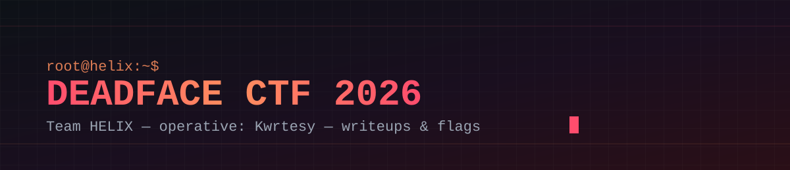

  

  
  
  
  

  
  
  
  
  

# DEADFACE CTF 2026 — Writeups

Writeups del equipo **HELIX** en el **DEADFACE CTF 2026** (`ctf.deadface.io`), documentados por **Kwrtesy** (José Félix Ureña Guevara). 27 retos resueltos a lo largo de 5 categorías, cada una con su metodología, herramientas, código de solución y lecciones aprendidas.

> Objetivo de este repo: portafolio técnico público, no un writeup "de carrera contra el tiempo" — cada entrada documenta el razonamiento completo, incluyendo los caminos que **no** funcionaron.

## ¿Qué es un CTF y qué significa este repo? (para quien no es de ciberseguridad)

Un **CTF** ("Capture The Flag") es una competencia donde te dan sistemas, archivos o sitios web con fallas de seguridad puestas a propósito, y tenés que encontrar una "bandera" (un código secreto) escondida detrás de cada falla — a veces es un bug en una página web, a veces un mensaje oculto dentro de una imagen, a veces una contraseña cifrada dentro de un programa. Es básicamente un examen práctico de seguridad informática hecho juego: no hay nada roto de verdad ni ningún dato real en riesgo, todo corre en servidores armados para el evento.

Resolver cada "bandera" significa entender cómo funciona algo por dentro (un programa, una página, una red) mejor de lo que su propio creador esperaba que alguien lo entendiera. Este repo es el registro de **cómo** llegué a cada una — no solo la respuesta final, sino el camino, las herramientas que usé y lo que entendí mal antes de entenderlo bien.

## Sobre mí y cómo trabajé esto

Soy estudiante de ciberseguridad, **no profesional ni senior** — este es mi tercer CTF, pero el primero que documento de verdad. Lo resolví yo, solo, con dos apoyos que uso de forma honesta y los menciono porque es la verdad: busqué información en internet cuando no sabía por dónde empezar, y usé herramientas de IA (Claude Code, opencode) como punto de partida para pensar distinto cuando estaba trabado — nunca para que me resolvieran el reto. La IA me tiraba ideas o perspectivas que no había visto del enunciado; la implementación, el entender *por qué* funcionaba, y el armar el exploit o el script, lo hice yo.

Para ser transparente: en varios de estos retos me trabé bastante, me tomó horas, hubo momentos en que dudé si esto era lo mío. Las técnicas más avanzadas (como SROP o el anti-debug de Cereal Killer 03) no las sabía de entrada — las aprendí investigando específicamente para ese reto. Eso está bien y es parte real del proceso de aprender seguridad: nadie sale sabiendo esto de memoria, se construye reto por reto.

## Índice por categoría

| Categoría | Retos | Técnicas principales |
|---|---|---|
| [`pwn/`](pwn/README.md) | 5 | ret2win, ROP con argumentos, reutilización de código del binario, ret2libc con PIE, SROP |
| [`reverse-engineering/`](reverse-engineering/README.md) | 7 | Crackmes ELF/PE/.NET, apps iOS/Swift, anti-debug (VEH + hardware breakpoints), AES/RC4/XOR custom |
| [`osint-web/`](osint-web/README.md) | 8 | robots.txt, certificados TLS, esteganografía Unicode, SQLi, OSINT de metadatos OOXML |
| [`forensics/`](forensics/README.md) | 2 | Análisis de tráfico HTTP (pcap), esteganografía en EXIF |
| [`hostbusters/`](hostbusters/README.md) | 5 | Post-explotación Linux: bash history, git log, cron hijacking, sudo NOPASSWD / GTFOBins |

## Metodología general

1. **Verificar integridad** del artefacto entregado (SHA256/SHA1) antes de analizar.
2. **Reconocimiento estático primero**: `file`, `strings`, `nm`/`readelf`, metadatos (EXIF/XMP/OOXML) — antes de desensamblar o explotar nada.
3. **Leer las pistas narrativas como instrucciones técnicas** ("TIME is REVERSIBLE" = invertir el índice de una key, no sabor de historia).
4. **No confiar en señuelos** que afirman explícitamente "esto no es la flag" — verificar igual.
5. **Documentar los caminos muertos**, no solo la solución — son la mitad del aprendizaje real.

## Stack de herramientas usado en la serie

`file` · `readelf` · `objdump` · `nm` · `r2`/`rabin2` · `gdb` · `strings` · `exiftool` · `sqlite3` · `tshark`/`tcpdump`/`capinfos` · `openssl` · `john` + `rockyou` · `pwntools` · Python 3 (`itertools`, `hashlib`, `zipfile`, `plistlib`) · `git log --all`

## Licencia

Contenido bajo licencia [MIT](LICENSE). Las flags documentadas pertenecen al CTF DEADFACE 2026 y se comparten con fines de portafolio/aprendizaje.
